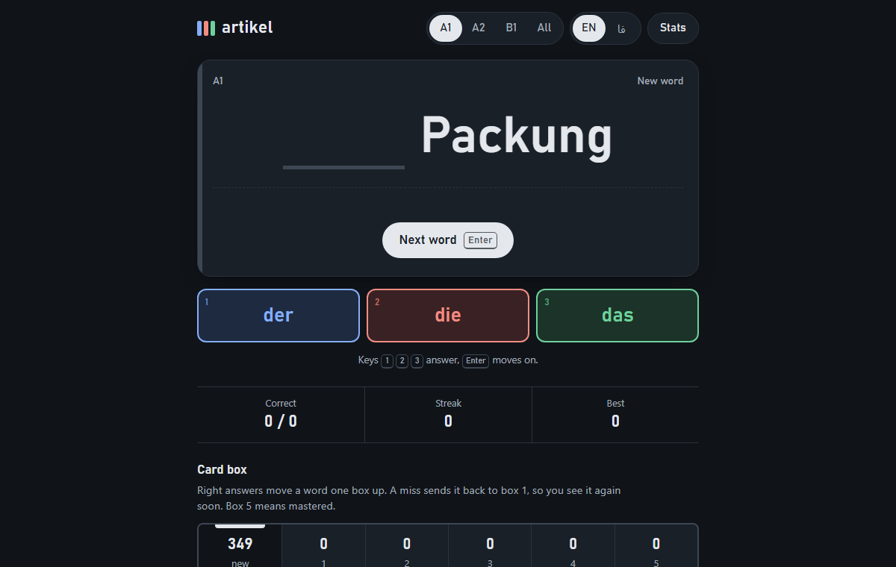

# artikel

Practise der, die and das with 900+ German nouns until the gender sticks.

**Try it:** https://a2m33.github.io/artikel/



## Features

- One noun at a time. You pick der, die or das with a tap or the keys 1, 2 and 3.
- After each answer you see the full noun with its article, the plural, and the meaning in English or Persian. Persian reads right to left.
- Miss a word that follows a gender pattern (-ung, -heit, -keit, -schaft, -ion and -tät take die; -chen, -lein, -ment and -um take das; -ling and -ismus take der; days, months and seasons take der) and you get the pattern as a hint.
- A five-box card system decides what comes next. A right answer moves a word up a box. A miss sends it back to box 1, so you meet it again within a few cards. Words in box 5 count as mastered.
- Score, current streak and best streak.
- Stats show your accuracy for each article and how many words you have mastered per level.
- Level filter for A1, A2, B1 or all words.
- Colours follow the classroom convention: blue for der, red for die, green for das.
- Light and dark themes follow your system setting. Big buttons on phones, full keyboard support, screen reader labels.
- Your progress lives in your browser's local storage. The page makes no network requests, and you can wipe everything with "Reset progress" in the stats panel.

## Run it locally

Download or clone the repository and open `index.html` in a browser. There is no build step and nothing to install. The page works offline.

To check the word list you need Node.js 18 or newer:

```
node tests/words.test.mjs
```

## How the word list is checked

`words.js` holds one noun per line: article, noun, plural, English, Persian, grouped by level. I kept the list to standard German as Duden gives it and left out three kinds of nouns:

- nouns with two genders or a meaning that changes with the article, such as der/die See, der/das Teil, das/der Band, die/der Leiter, der/das Joghurt and der/das Bonbon
- nouns you almost only meet in the plural, such as Eltern, Leute and Ferien
- adjectival nouns like der/die Deutsche, where the article depends on the person

A dash in the plural column means the noun has no plural in everyday use (die Milch, das Obst).

`tests/words.test.mjs` runs on every push through GitHub Actions. It fails if the list has fewer than 600 nouns, a duplicate, an article other than der, die or das, an empty field, a level outside A1, A2 and B1, or any noun from the exclusion list. If you spot a wrong gender, plural or translation, please open an issue.

## License

MIT. See [LICENSE](LICENSE).
