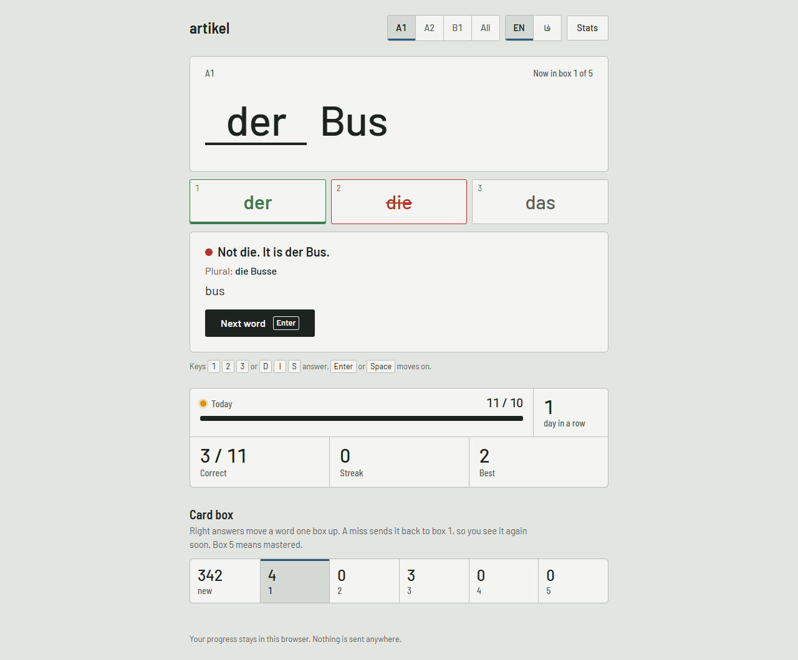
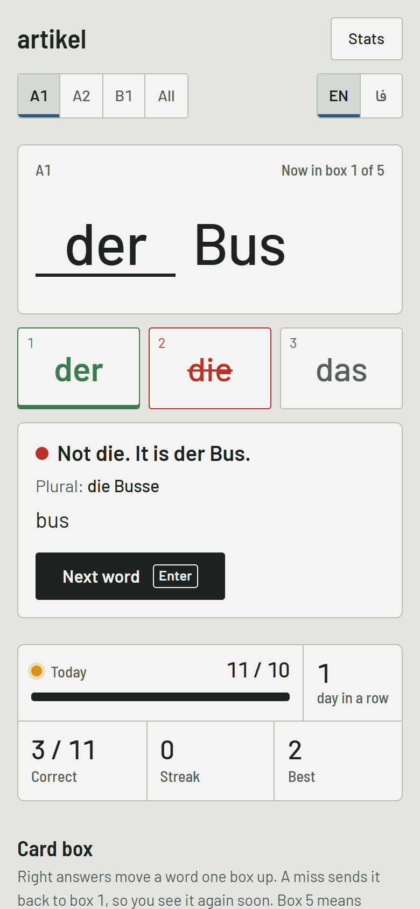
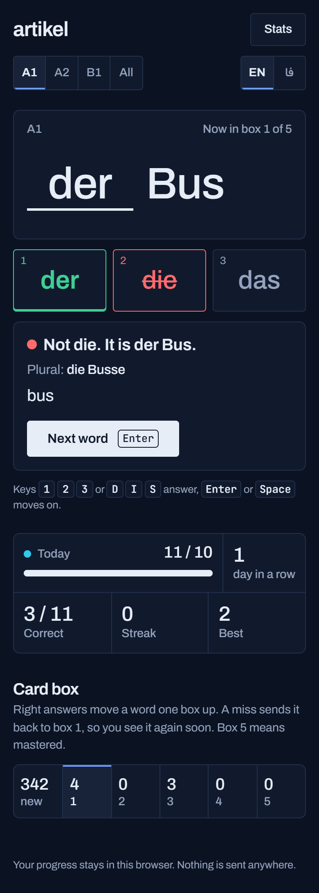

# artikel

[](https://github.com/A2M33/artikel/actions/workflows/test.yml)

A small web app for drilling der, die and das on 909 German nouns from A1 to B1. Play it at https://a2m33.github.io/artikel/

<picture>
  <source media="(prefers-color-scheme: dark)" srcset="docs/desktop-dark.png">
  
</picture>

I built it while preparing for an Ausbildung in Germany.

On a phone the buttons fill the width and the controls wrap onto two rows:

<p>
  
  
</p>

## How it works

Each card shows one noun. Tap an article or press 1, 2 or 3 (or D, I and S), then Enter or Space for the next card. The keys go by position on the keyboard, so they also work with a Persian layout.

After you answer, the card shows the article and the plural, with the meaning in English or Persian. If your browser has a German voice it reads the result aloud, as in "der Gast". The speaker button turns that off and the app remembers the setting. Miss a noun that follows a gender rule and the card shows you the rule from the [hint table](#hints).

Five boxes decide which noun comes next. A right answer moves the noun up a box. A miss sends it back to box 1, so you see it again within a few cards. A noun you get right the first time starts in box 3. Box 5 counts as mastered, and the verdict tags the noun "Mastered" when it gets there.

Other things it does:

- Switch to فا and the interface turns Persian and right to left. German words stay left to right.
- Limit the cards to A1, A2 or B1, or practise all levels together.
- The stats panel has your score, your current and best streak, accuracy per article, mastered nouns per level and the eight nouns you miss most (with the miss count and the box each one sits in).
- Set a daily goal of 10, 20, 30 or 50 cards. A bar shows today's count and a counter tracks the days in a row you met the goal.
- Right and wrong picks get a bar or a strike-through as well as green or red, and the verdict says it in words.
- The theme follows your system's light or dark setting. Screen readers get labels.
- Progress stays in your browser's local storage, and the page loads nothing beyond its own files. "Reset progress" in the stats panel clears it.
- After the first visit it works offline, and you can install it to your home screen or desktop.

## Hints

| Article | Endings and word groups | Share of matching nouns in the list |
|---------|-------------------------|-------------------------------------|
| die | -ung, -heit, -keit, -schaft, -tät, -ion, -ie, -ei, -ik, -ur, -enz, -anz | 90% or more |
| die | most nouns ending in -e | 90% (der Name, das Auge and der Käse break it) |
| die or das | -nis | all of them |
| das | -chen, -lein, -ment, -um (das Datum, das Museum, das Studium) | 90% or more |
| das | many nouns starting with Ge- | 56% (die Geschichte, der Gedanke) |
| der | -ling, -ismus, -eur, days of the week, months, seasons | 90% or more |

Compound nouns get their own hint. Miss die Hauptstadt and the card tells you that a compound takes the article of its last part: die Stadt. I marked 65 clear compounds by hand in `words.js`, such as das Krankenhaus and der Kühlschrank. Words like die Bewerbung or der Umzug only look like compounds, so they get no head.

The app shows a hint only when the noun follows the rule. Exceptions such as der Kuchen or das Stadion get no hint, so you won't learn a rule that contradicts the word in front of you. The -ie, -ei, -ik, -ur and -anz rules skip one-syllable nouns, which is why der Tanz and das Knie don't count against them.

`tests/rules.test.mjs` measures each rule against the word list and fails if a rule drops below what its hint says: 90% for a plain rule, 80% for "most" and 50% for "many".

## Run it locally

Download or clone the repository and open `index.html` in a browser. There is no build step and nothing to install.

The tests need Node.js 18 or newer:

```
node tests/words.test.mjs
node tests/rules.test.mjs
node tests/page.test.mjs
node tests/app.test.mjs
```

The screenshots in this README come from the real app. `python tools/screens/render.py` takes them in a headless Edge, which needs Python and Playwright.

## The word list

`words.js` holds one noun per line with its article, plural, English and Persian meaning, grouped by level. I followed standard German as Duden gives it and left out three kinds of nouns:

- nouns with two genders or a meaning that changes with the article, such as der/die See, der/das Teil, das/der Band, die/der Leiter, der/das Joghurt and der/das Bonbon
- nouns you meet almost only in the plural, such as Eltern, Leute and Ferien
- adjectival nouns like der/die Deutsche, where the article depends on the person

A dash in the plural column marks a noun with no plural in everyday use (die Milch, das Obst). An optional sixth column names the head of a compound, as in `die|Hauptstadt|Hauptstädte|capital city|پایتخت|Stadt`. The test checks that the head is in the list, ends the compound and has the same article.

GitHub Actions runs `tests/words.test.mjs` on every push. The test fails if the list drops below 600 nouns or contains a duplicate. It also catches an article other than der, die or das, an empty field, a level outside A1 to B1, and any noun from the exclusion list.

If you spot a wrong gender, plural or translation, please open an issue.

## License

MIT. See [LICENSE](LICENSE). The Archivo, JetBrains Mono and Vazirmatn fonts in `fonts/` are under the SIL Open Font License (`fonts/OFL-Archivo.txt`, `fonts/OFL-JetBrainsMono.txt`, `fonts/OFL-Vazirmatn.txt`).
