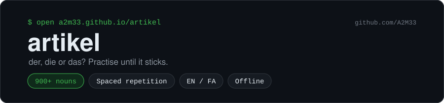

<p align="center"></p>

<p align="center">
  <a href="https://a2m33.github.io/artikel/"></a>
  <a href="https://github.com/A2M33/artikel/actions/workflows/test.yml"></a>
  <a href="https://github.com/A2M33/artikel/blob/main/LICENSE"></a>
</p>

artikel drills der, die and das on over 900 German nouns from A1 to B1. You answer one card at a time until the genders stick. I built it while preparing for an Ausbildung in Germany.

**Try it:** https://a2m33.github.io/artikel/


## Features

- Each card shows one noun. You answer with a tap, with the keys 1, 2 and 3, or with D, I and S for der, die and das. Enter or Space takes you to the next card. The keys follow their position, so they work with a Persian keyboard layout too.
- After you answer, the card shows the article and the plural, with the meaning in English or Persian.
- Switch to فا and the whole interface turns Persian: buttons, verdicts, hints, stats and numbers, laid out right to left. The German words stay left to right.
- After each answer your browser reads the article and noun aloud, as in "der Gast". The speaker button turns this off and the app remembers your choice. Browsers without a German voice skip it and hide the button.
- If you miss a noun that follows a gender rule, the card shows you the rule. The [hint table](#hints) lists them.
- Five boxes decide which noun comes next. A right answer moves the noun up a box, and a miss sends it back to box 1 so you see it again within a few cards. A noun you get right the first time starts in box 3, and box 5 counts as mastered.
- The app tracks your score and your current and best streak.
- You set a daily goal of 10, 20, 30 or 50 cards in the stats panel. A bar shows how many cards you have done today, and a counter shows how many days in a row you have met the goal.
- When a noun reaches box 5, the card marks it as mastered with a short burst in the der, die and das colours. If your system asks for reduced motion, you get the badge without the animation.
- The stats panel shows your accuracy for each article and how many nouns you have mastered per level. It also lists the eight nouns you miss most, with how often you missed each one and which box it sits in.
- You can limit the cards to A1, A2 or B1, or practise all levels together.
- Colours follow the classroom convention: blue for der, red for die, green for das.
- The light or dark theme follows your system setting. Buttons are large on phones, and screen readers get labels.
- Your progress stays in your browser's local storage, and the page makes no network requests beyond loading its own files. "Reset progress" in the stats panel clears it.
- After your first visit the game works offline. You can install it to your home screen or desktop like an app.

## Hints

| Article | Endings and word groups | Share of matching nouns in the list |
|---------|-------------------------|-------------------------------------|
| die | -ung, -heit, -keit, -schaft, -tät, -ion, -ie, -ei, -ik, -ur, -enz, -anz | 90% or more |
| die | most nouns ending in -e | 90% (der Name, das Auge and der Käse break it) |
| die or das | -nis | all of them |
| das | -chen, -lein, -ment, -um (das Datum, das Museum, das Studium) | 90% or more |
| das | many nouns starting with Ge- | 56% (die Geschichte, der Gedanke) |
| der | -ling, -ismus, -eur, days of the week, months, seasons | 90% or more |

Compound nouns get their own hint. Miss die Hauptstadt and the card tells you that a compound takes the article of its last part: die Stadt. I marked 65 clear compounds by hand in `words.js`, such as das Krankenhaus and der Kühlschrank. Words like die Bewerbung or der Umzug only look like compounds, so they get no head.

The app shows a hint only when the noun follows the rule. Exceptions such as der Kuchen or das Stadion get no hint, so you won't learn a rule that contradicts the word in front of you. The -ie, -ei, -ik, -ur and -anz rules skip one-syllable nouns, which is why der Tanz and das Knie don't count against them.

`tests/rules.test.mjs` measures each rule against the word list and fails if a rule drops below what its hint says: 90% for a plain rule, 80% for "most" and 50% for "many".

## Run it locally

Download or clone the repository and open `index.html` in a browser. You don't need a build step or any installs, and the page works offline.

The tests need Node.js 18 or newer:

```
node tests/words.test.mjs
node tests/rules.test.mjs
node tests/page.test.mjs
```

## The word list

`words.js` holds one noun per line with its article, plural, English and Persian meaning, grouped by level. I followed standard German as Duden gives it and left out three kinds of nouns:

- nouns with two genders or a meaning that changes with the article, such as der/die See, der/das Teil, das/der Band, die/der Leiter, der/das Joghurt and der/das Bonbon
- nouns you meet almost only in the plural, such as Eltern, Leute and Ferien
- adjectival nouns like der/die Deutsche, where the article depends on the person

A dash in the plural column marks a noun with no plural in everyday use (die Milch, das Obst). An optional sixth column names the head of a compound, as in `die|Hauptstadt|Hauptstädte|capital city|پایتخت|Stadt`. The test checks that the head is in the list, ends the compound and has the same article.

GitHub Actions runs `tests/words.test.mjs` on every push. The test fails if the list drops below 600 nouns or contains a duplicate. It also catches an article other than der, die or das, an empty field, a level outside A1 to B1, and any noun from the exclusion list.

If you spot a wrong gender, plural or translation, please open an issue.

## License

MIT. See [LICENSE](LICENSE).
